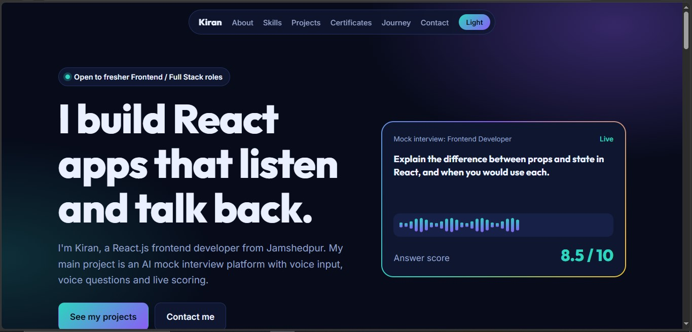
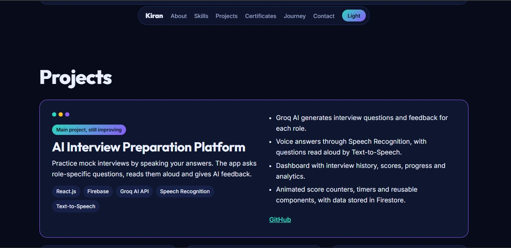
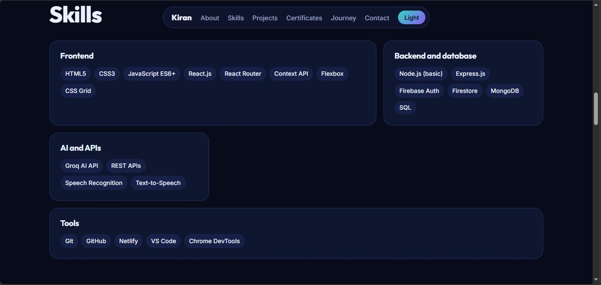
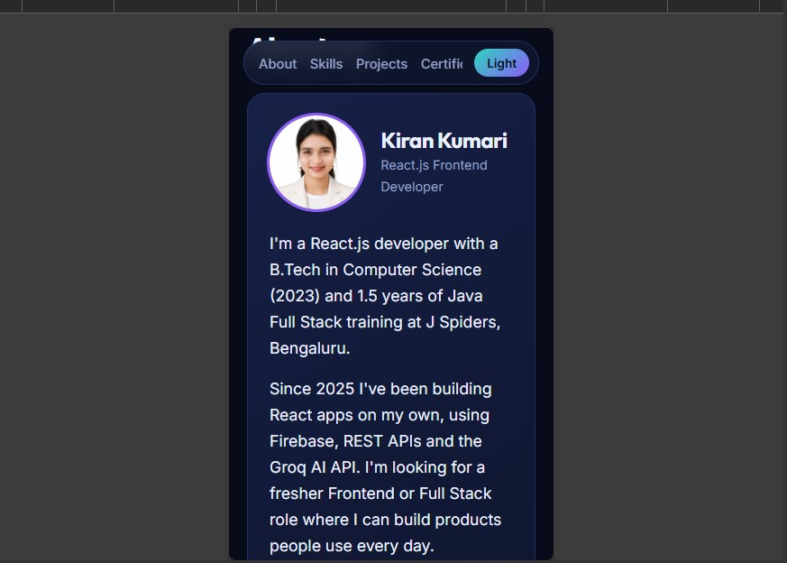

# Kiran Kumari - Portfolio (React + Vite)

A fully responsive personal portfolio website showcasing my projects, skills and certificates.

🔗 **Live Demo:** https://kiran-kumari-portfolio.netlify.app


## Tech Stack
- React.js
- Vite
- JavaScript, CSS3, HTML5

## Features
- Fully responsive (laptop + mobile)
- About, Skills, Projects and Certificates sections
- All content editable from one file (`src/data.js`)

## Screenshots

### Projects


### Skills


### Mobile View


## Projects Featured
- AI Interview Preparation Platform
- Kivon Luxe E-commerce Website
- Weather Forecast Application

## Run locally
```bash
npm install
npm run dev
```

## Build for deployment
```bash
npm run build
```
Upload the `dist` folder to Netlify (drag and drop), or connect the GitHub repo with build command `npm run build` and publish directory `dist`.

## Edit your content
All portfolio content is in `src/data.js`.

## Contact
- LinkedIn: https://linkedin.com/in/kirankumari-dev
- GitHub: https://github.com/kiku5858
- Gmail: kirankumari20850@gmail.com